### Sen Peng

I am an AI algorithm engineer at [Unitree Robotics](https://www.unitree.com/), working on the deployment of advanced robot policies on real hardware. I received my B.E. in Computer Science and Technology from Southern University of Science and Technology (SUSTech) and my Ph.D. in Computer Science from City University of Hong Kong, where my research focused on AI security, particularly the security of diffusion models.

The G1 above falls once per lap. Still training.

[Homepage](https://senp98.github.io/) / [Google Scholar](https://scholar.google.com/citations?user=7jRjatEAAAAJ) / [senpengeden@gmail.com](mailto:senpengeden@gmail.com)
